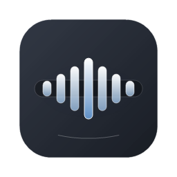
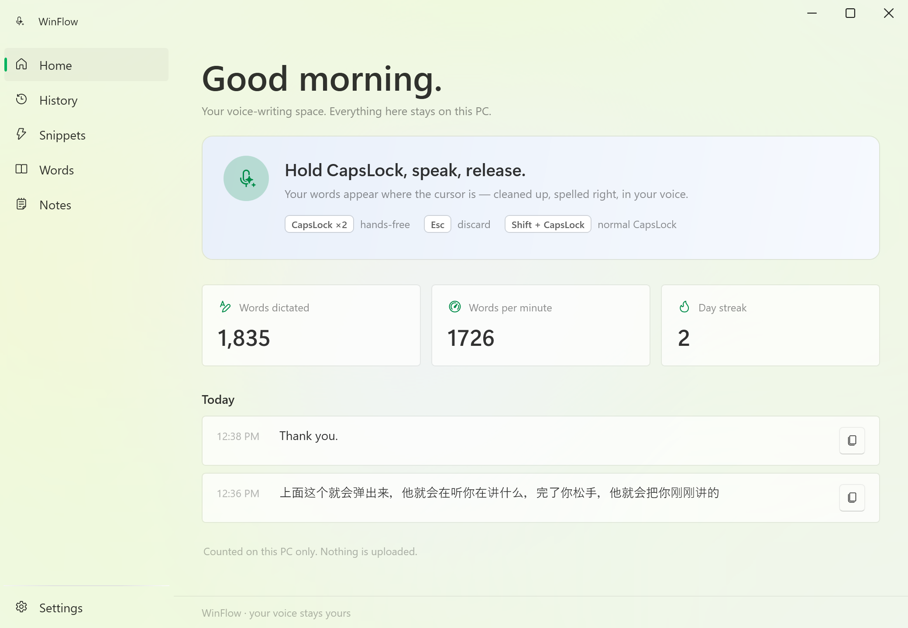
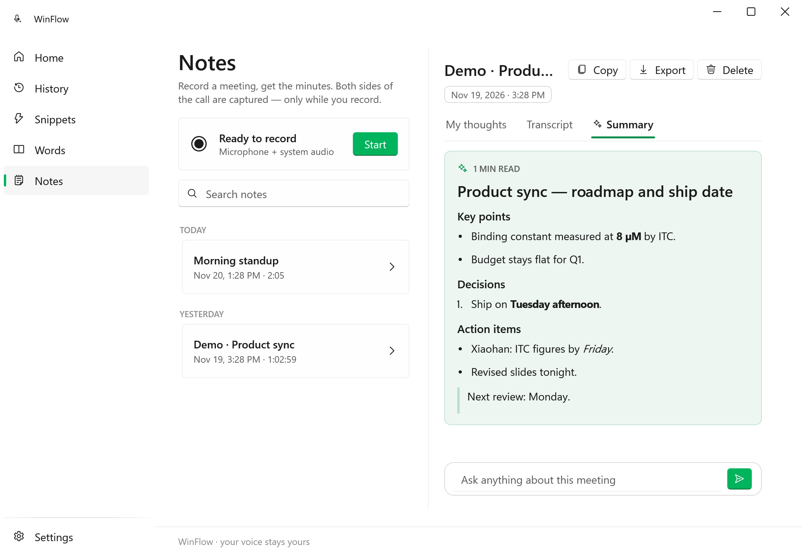
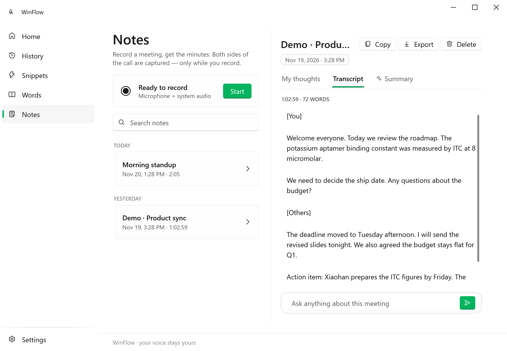
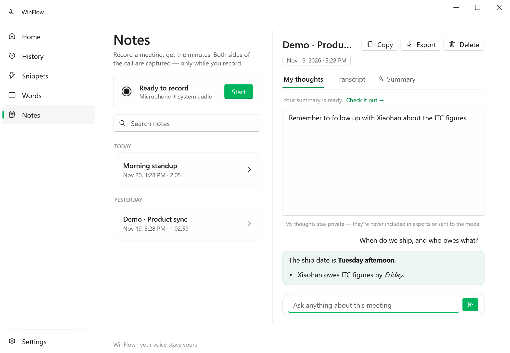
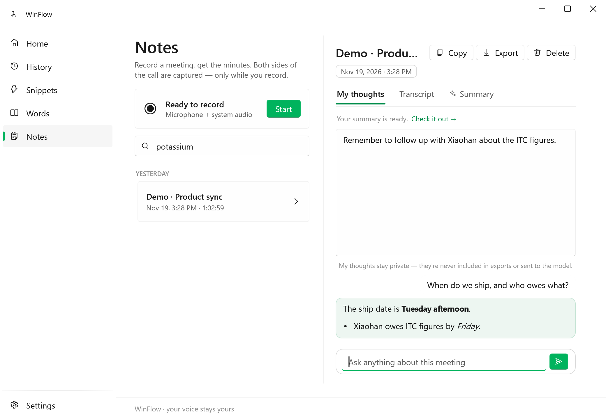

<p align="center">
  
</p>

<h1 align="center">WinFlow</h1>

<p align="center">
  <strong>Native, Privacy-First Speech-to-Text Dictation, In-Place AI Text Transformation & Meeting Intelligence for Windows.</strong>
</p>

<p align="center">
  <a href="https://github.com/blakejjia/winflow/releases/latest"></a>
  <a href="https://github.com/blakejjia/winflow/actions"></a>
  
  
  
  <a href="LICENSE"></a>
</p>

<p align="center">
  <a href="#-downloads">Downloads</a> •
  <a href="#-visual-showcase">Showcase</a> •
  <a href="#-key-features">Features</a> •
  <a href="#%EF%B8%8F-keyboard-shortcuts">Shortcuts</a> •
  <a href="#-getting-started">Getting Started</a> •
  <a href="#%EF%B8%8F-tech-stack">Tech Stack</a>
</p>

---

WinFlow is a native Windows desktop utility designed for lightning-fast speech-to-text dictation, in-place AI text editing, and intelligent meeting transcription. A opensource, free wisper flow alternative.

Bring your own API key (Groq, OpenAI, Ollama, or any OpenAI-compatible endpoint) and enjoy ultra-fast, privacy-first voice writing without monthly subscription lock-ins.

---

## 📸 Visual Showcase

<div align="center">

### 🎙️ The Voice-Writing Space
*Personal dashboard with today's dictations, WPM speed, streak tracker, and audio device control.*



<br/><br/>

### 📋 Wispr-Flow Style Meeting Intelligence
*Simultaneous dual-loop recording (Mic + System Audio), auto map-reduce summarization, and grounded Q&A.*

| 📝 Themed Markdown Minutes | 💬 Diarized Conversation | 🤖 Grounded Meeting Q&A |
| :---: | :---: | :---: |
|  |  |  |
| *Auto-structured minutes, action items & reading time* | *Dual-speaker bubbles (`[You]` vs `[Others]`)* | *Streaming Q&A strictly grounded in the meeting* |

<br/>

### 🗂️ Chronological Meeting Library
*Date-grouped meeting timeline (Today, Yesterday, Date headers) with real-time keyword search.*



</div>

---

## ✨ Key Features

### 🎙️ Push-to-Talk & Smart Lock Modes
- **Push-to-Talk**: Hold <kbd>CapsLock</kbd> to record, release to transcribe and paste directly into the active application.
- **Hands-Free Lock Mode**: Double-tap <kbd>CapsLock</kbd> to lock recording for long dictations.
- **Non-Activating Floating Overlay HUD**: A sleek, minimal waveform bar floats on screen while recording, providing real-time audio visualization without ever stealing keyboard or window focus.
- **Accidental-Tap Guard & Game Passthrough**: Normal taps pass through cleanly; automatically suspends hotkeys when fullscreen games or elevated admin windows are active.

### 🧠 In-Place AI Text Transformation
- **Context-Aware Editing**: Automatically detects selected text in your foreground window (VS Code, Word, Chrome, Notion, Slack).
- **Spoken Instructions**: Speak commands like *"translate to French"*, *"format as JSON"*, or *"make this concise"* to rewrite highlighted text directly in place.
- **Active Window Context**: WinFlow inspects active application titles and process information to ground transcription spelling and syntax.

### 📋 Intelligent Meeting Notes
- **Dual-Channel Loopback Audio**: Captures your local microphone and system audio (e.g. Zoom, Teams, Google Meet, YouTube) simultaneously.
- **Map-Reduce Long Summaries**: Multi-hour meetings are automatically condensed section by section without hitting prompt token limits.
- **Ask Note AI**: Interactive chat box right inside the note page. Ask questions with streaming responses grounded strictly in the meeting transcript and minutes.
- **Private "My Thoughts"**: Dedicated local scratchpad with debounced auto-saving—strictly private and never sent to cloud models or exported.

### ⚡ Instant Offline Snippets & Custom Vocabulary
- **Zero-Latency Snippet Expander**: Speak trigger phrases to instantly expand templates (e.g., *"my email"* → `you@example.com`) without network or AI latency.
- **Personal Words Dictionary**: Teach WinFlow your specific technical jargon, acronyms, and proper names for 100% spelling precision.

### 🛡️ Privacy & Local Security First
- **Hardware-Backed Encryption**: Sensitive API keys are protected using **Windows DPAPI** (Data Protection API).
- **Safe Clipboard Handling**: Backs up your existing clipboard before text insertion and restores it immediately.
- **Zero Telemetry**: No tracking, no background analytics, and no remote audio storage. All notes and history are stored locally in standard JSON.

---

## ⌨️ Keyboard Shortcuts

| Shortcut | Interaction | Behavior |
| :--- | :--- | :--- |
| **Hold <kbd>CapsLock</kbd>** | Push-to-Talk | Records while held down; transcribes and pastes upon release |
| **Double-tap <kbd>CapsLock</kbd>** | Hands-Free Lock | Starts continuous hands-free recording session |
| **Tap <kbd>CapsLock</kbd>** | Stop & Paste | Stops active hands-free recording and pastes transcription |
| **<kbd>Shift</kbd> + <kbd>CapsLock</kbd>** | Native Toggle | Standard Windows CapsLock capitalization toggle |
| **<kbd>Escape</kbd>** | Cancel | Aborts current recording without transcribing or pasting |

---

## 📦 Downloads

Choose the package that suits your preference from the **[Latest Release (v1.0.0)](https://github.com/blakejjia/winflow/releases/latest)**:

| Distribution | File | Description |
| :--- | :--- | :--- |
| **Setup Wizard** *(Recommended)* | `WinFlow-1.0.0-Setup.exe` | Standard Windows installer with desktop/start menu shortcuts, per-user setup, and clean uninstaller |
| **Portable Single-File** | `WinFlow-v1.0.0-Portable.exe` | Fully self-contained single executable. Zero dependencies, run anywhere |
| **Portable Zip** | `WinFlow-v1.0.0-Portable.zip` | Standalone executable bundled with README and documentation |
| **Checksums** | `SHA256SUMS.txt` | Cryptographic verification hashes for all release artifacts |

---

## 🚀 Getting Started

### Prerequisites
- **OS**: Windows 10 (1809+) or Windows 11 (x64)
- **.NET Runtime**: Pre-packaged in the self-contained releases. (For building from source, install [.NET 10 SDK](https://dotnet.microsoft.com/download/dotnet/10.0)).
- **API Key**: An API key from [Groq](https://console.groq.com/) (recommended for near-instant Whisper transcription), OpenAI, or any local OpenAI-compatible endpoint (Ollama, vLLM, LM Studio).

### Configuration
1. Launch WinFlow (it will appear in your Windows System Tray).
2. Open **Settings → AI & models**.
3. Enter your API Key and preferred models:
   - **Transcription Model**: `whisper-large-v3-turbo` (or `whisper-large-v3`)
   - **Post-Processing Model**: `llama-3.3-70b-versatile` or `openai/gpt-oss-20b`
4. Press <kbd>Save</kbd>. Settings apply immediately without restarting!

---

## 🛠️ Building from Source

```powershell
# 1. Clone the repository
git clone https://github.com/blakejjia/winflow.git
cd winflow

# 2. Build and launch detached
./run.ps1

# 3. Run unit tests
dotnet test tests/WinFlow.Tests/WinFlow.Tests.csproj

# 4. Publish self-contained executable locally
./scripts/publish.ps1
```

---

## 🏗️ Tech Stack & Architecture

- **UI Framework**: WPF on modern .NET 10 with [WPF-UI](https://github.com/lepoco/wpfui) (Windows 11 Fluent Design & Mica/Acrylic styling)
- **Audio Engine**: WASAPI (Windows Audio Session API) via NAudio for low-latency microphone and system loopback capture
- **Overlay Window**: Pure Win32 layered window (`UpdateLayeredWindow` + GDI/DIB section) for transparent, hardware-accelerated floating HUD with zero window activation/focus-stealing
- **Markdown Rendering**: [Markdig](https://github.com/xoofx/markdig) + [Neo.Markdig.Xaml](https://github.com/neocan/Neo.Markdig.Xaml) mapped into native WPF `FlowDocument`
- **Installer**: [Inno Setup 6](https://jrsoftware.org/isinfo.php) with non-elevated per-user installation support

---

## 📄 License

This project is open-source software licensed under the **[MIT License](LICENSE)**.
